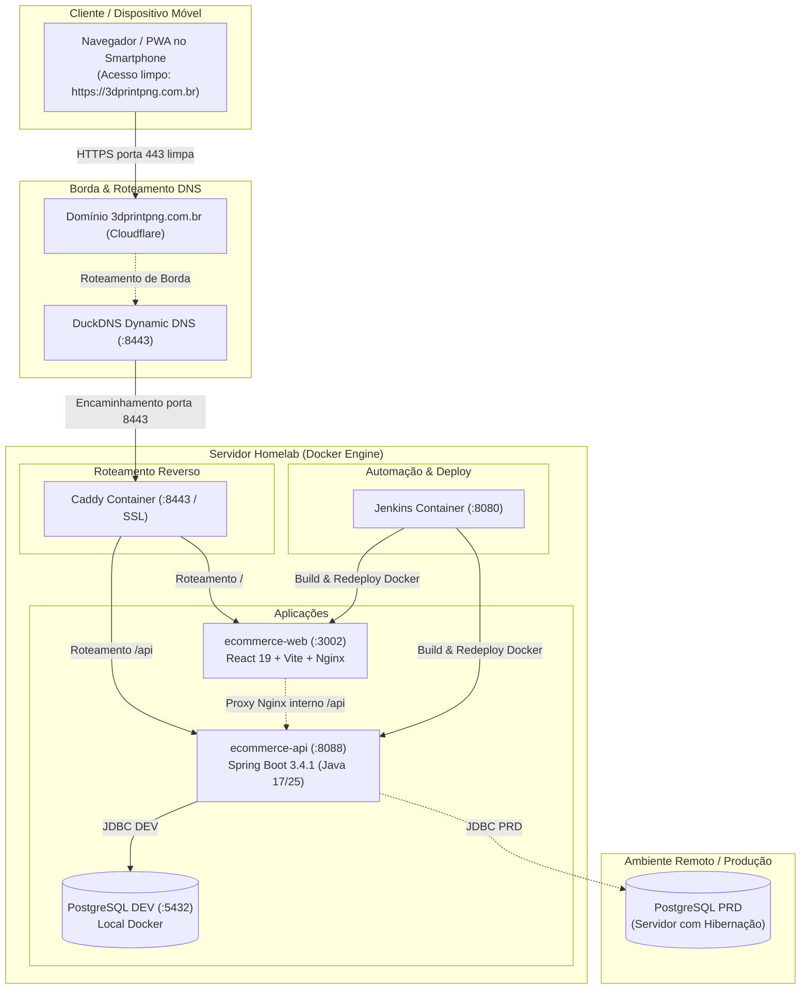
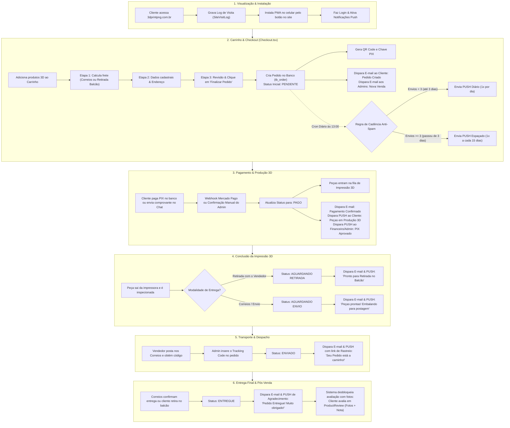
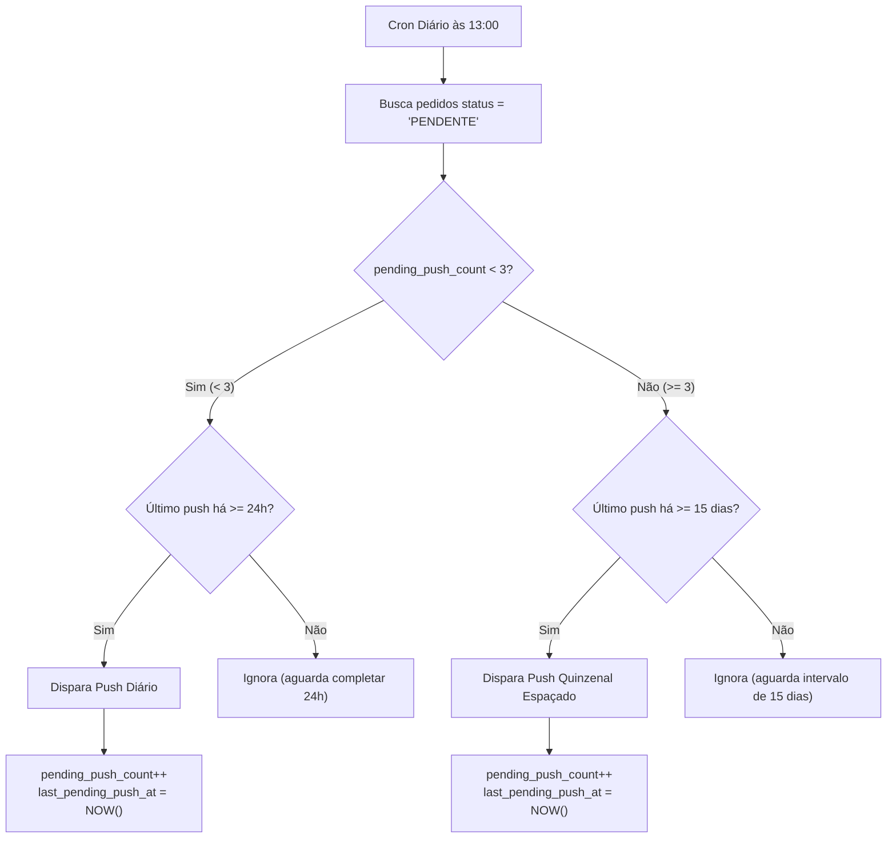
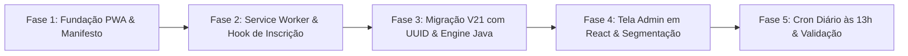

# Arquitetura PWA e Notificações Push (Web Push)
**Projeto:** E-commerce Loja 3D (3DPrintPNG)  
**Domínio Oficial Confirmado:** `https://3dprintpng.com.br`  
**Data:** 01/11/2026  
**Status:** Especificação Arquitetural e Implementação Completa Concluída (Front-end & Back-end Validados)  
**Autor:** Especialista em Arquitetura de Nuvem, React, Java e Mobile

---

## 1. Resumo e Objetivo

Este documento consolida a investigação arquitetural e o planejamento técnico para transformar a aplicação web da **Loja 3D (3DPrintPNG)** em uma experiência instalável no celular com aparência de aplicativo nativo (**Progressive Web App - PWA**), acompanhada de suporte completo a **notificações push (Web Push)** enviadas pelo back-end Java, com um botão contextual de instalação na interface do site e um módulo administrativo para gestão de envios e auditoria de entrega.

### Objetivos Principais
1. **Instalabilidade móvel (A2HS - Add to Home Screen):** Permitir que usuários adicionem o e-commerce à tela inicial de seus smartphones (Android e iOS) com ícone dedicado, tela de carregamento (splash screen) e execução em modo de tela cheia/standalone (sem barra de URL do navegador).
2. **Botão de instalação inteligente na interface:** Disponibilizar um botão ou banner no front-end React convidando o usuário a instalar o aplicativo, adaptando-se às peculiaridades do Android (disparo do diálogo nativo) e do iOS (modal de orientação passo a passo).
3. **Notificações Push com Segmentação por Perfis Reais do Sistema:**
   * **Campanhas de Marketing Manuais:** Permitir que administradores redijam e enviem notificações push promocionais ou institucionais diretamente pelo painel administrativo da loja.
   * **Segmentação Dinâmica por Nome de Role (`tb_role.name`):** Disparar notificações segmentadas para os perfis validados no banco (**`USUARIO`**, **`ADMINISTRADOR`** e **`FINANCEIRO`**), buscando sempre pelo **nome** da role e nunca assumindo que os UUIDs de roles sejam idênticos entre os ambientes DEV e PRD.
   * **Cadência Inteligente de Carrinho / Pedido Pendente (Anti-Spam):**
     * Execução diária pontualmente às **13:00**.
     * **Ciclo Inicial:** Limite de até **3 notificações** (uma a cada 24 horas nos primeiros 3 dias).
     * **Ciclo Recorrente Espaçado:** Passou de 3 dias (3 notificações enviadas), o lembrete passa a ser enviado apenas **uma vez a cada 15 dias** enquanto o pedido continuar `PENDENTE`.
   * **Inscrições Restritas a Usuários Autenticados:** O cadastro da inscrição de push é vinculado diretamente ao `tb_user.id` (UUID), simplificando a conformidade com a LGPD e evitando disparos órfãos.
4. **Módulo Administrativo de Disparo e Validação:** Disponibilizar uma nova tela no menu administrativo (`/admin/notificacoes`), desenvolvida em React seguindo o padrão das páginas já existentes em `src/pages/admin/`, com histórico e métricas de entrega (sucessos e falhas).
5. **Custo Zero Real sem Intermediários Pagos:** Priorizar o padrão aberto **W3C Web Push** com chaves **VAPID (RFC 8292)**, comunicando-se diretamente com os serviços de push nativos dos fornecedores de navegadores e sistemas operacionais (Apple APNs, Google FCM, Mozilla Autopush), sem taxas de desenvolvedor ou mensalidades em dólar.
6. **Preservação e Robustez da Infraestrutura:** Manter a integridade do homelab atual (Docker, Caddy, Jenkins, PostgreSQL, Spring Boot e React) sob a origem limpa e estável `https://3dprintpng.com.br`.
7. **Padrão Estrito de UUID e Desacoplamento entre DEV e PRD:** Todas as chaves primárias e relacionamentos adotam rigorosamente o padrão **`UUID`** nativo do projeto. Nenhuma lógica de aplicação ou consulta deve assumir que os UUIDs das roles são iguais em DEV e PRD, utilizando sempre `findByName(...)` e junções por `name`.

---

## 2. Arquitetura Atual Conhecida

A topologia do ambiente atual identificada no repositório e nas validações de código e infraestrutura é composta pelas seguintes camadas:



### Componentes Identificados e Validados no Código
* **Domínio e Origem:** Exposição externa sob o domínio limpo **`https://3dprintpng.com.br`** (sem porta aparente no navegador do usuário). Isso garante que o escopo de segurança do Service Worker seja perene e imutável.
* **Front-end (`ecommerce-web`):** SPA desenvolvida com **React 19.2.7**, **Vite 8.1.1**, **TypeScript**, servida pelo Nginx na porta interna 80 (mapeada para `3002:80`). Páginas administrativas concentradas em `src/pages/admin/` (`Dashboard.tsx`, `Visitors.tsx`, `Products.tsx`, etc.).
* **Back-end (`ecommerce-api`):** API REST em **Spring Boot 3.4.1** (Java 17 conforme `pom.xml`), Spring Security, JPA e Flyway (com 20 migrações aplicadas até o momento).
* **Entidades e Chaves no Código:**
  * Todas as entidades do projeto utilizam **`UUID`** como chave primária (`tb_user.id UUID`, `tb_role.id UUID`, `tb_order.id UUID`, `tb_product.id UUID`, etc.).
  * Perfis de acesso cadastrados em `tb_role`: **`ADMINISTRADOR`**, **`FINANCEIRO`** e **`USUARIO`**.
  * **Regra de Ouro:** O UUID específico da role `ADMINISTRADOR` (ou de qualquer outra) **não pode ser assumido como idêntico em DEV e PRD**. O sistema sempre pesquisa e filtra pelo campo `name`.
* **Banco de Dados (Dois Ambientes):**
  * **Ambiente DEV:** PostgreSQL local no contêiner Docker `3dprintpng-postgres`.
  * **Ambiente PRD:** Banco de dados de produção gerenciado separadamente (com comportamento de hibernação/sleep por inatividade).
* **Proxy Reverso Interno:** **Caddy** em contêiner Docker, responsável pelo término TLS e distribuição das requisições para a porta do front-end e back-end.
* **CI/CD:** Servidor **Jenkins** em contêiner com pipelines declarativas independentes para API e Web.

---

## 3. Informações Confirmadas, Hipóteses e Pendências

| Categoria | Item | Detalhamento |
| :--- | :--- | :--- |
| **Confirmado** | Domínio e Origem do Site | Exposição limpa e validada em **`https://3dprintpng.com.br`** (porta padrão 443 para o cliente). Não há vazamento de portas não padrão na URL. |
| **Confirmado** | Padrão Universal de Chaves | **Todos os identificadores do projeto são estritamente UUIDs.** As novas tabelas (`push_subscriptions`, `push_campaigns`, `push_delivery_receipts`) terão chaves primárias e estrangeiras como `UUID`. |
| **Confirmado** | Desacoplamento de Roles DEV vs PRD | O ID da role `ADMINISTRADOR` ou `FINANCEIRO` pode variar entre DEV e PRD. **É terminantemente proibido usar UUIDs estáticos ou fixos no código.** O vínculo e a filtragem são feitos dinamicamente por `r.name` ou `roleRepository.findByName(name)`. |
| **Confirmado** | Perfis de Usuário Existentes | Validados em `tb_role`: **`ADMINISTRADOR`**, **`FINANCEIRO`** e **`USUARIO`**. |
| **Confirmado** | Perfil dos Inscritos em Push | Restrito a **usuários autenticados (logados)**, gravando a inscrição atrelada ao `user_id UUID`. |
| **Confirmado** | Cadência de Pedidos Pendentes | Execução diária às **13:00** (`@Scheduled(cron = "0 0 13 * * ?", zone = "America/Sao_Paulo")`).<br/>- **Ciclo inicial:** Máximo de **3 notificações** (1 por dia durante os primeiros 3 dias).<br/>- **Ciclo estendido:** Passou de 3 dias/notificações, envia apenas **uma vez a cada 15 dias**. |
| **Confirmado** | Painel Administrativo de Push | Nova tela em `src/pages/admin/PushNotifications.tsx`, acessível via rota `/admin/notificacoes` para usuários com perfil `ADMINISTRADOR`. |
| **Confirmado** | Próxima Migração Flyway | A última versão existente é a `V20`. A migração de push será a **`V21__create_table_push_notifications.sql`** (incluindo as colunas de controle `pending_push_count` e `last_pending_push_at` em `tb_order`). |
| **Confirmado** | Ciclo de Status do Pedido | Mapeado no código (`OrderEmailService.java`, `ProductReviewService.java`, `STATUS_CARDS_DESIGN.md`): `PENDENTE` $\rightarrow$ `PAGO` $\rightarrow$ `AGUARDANDO RETIRADA` ou `AGUARDANDO ENVIO` $\rightarrow$ `ENVIADO` $\rightarrow$ `ENTREGUE` (além de `CANCELADO`). |

---

## 4. Alternativas Avaliadas

| Critério | PWA Puro (W3C Web Push + VAPID) | PWA com TWA (Google Play Store) | Wrapper Híbrido (Capacitor) | App Nativo (React Native / Flutter) |
| :--- | :--- | :--- | :--- | :--- |
| **Custo Inicial de Lojas** | **R$ 0,00** (Sem taxas de desenvolvedor). | **US$ 25** (taxa única da Google Play Console). | **US$ 25** (Google) + **US$ 99/ano** (Apple). | **US$ 25** (Google) + **US$ 99/ano** (Apple). |
| **Custo de Envio de Push** | **R$ 0,00** (Usa gateways nativos APNs/FCM via VAPID). | **R$ 0,00** (FCM nativo). | **R$ 0,00** a **Pago** (OneSignal com mensalidades após 10k inscritos). | **R$ 0,00** a **Pago** (FCM/APNs ou provedor SaaS). |
| **Esforço de Código** | **Baixo:** Manifesto, Service Worker, hook React, tela de admin e serviço Java. | **Médio:** Requer geração de APK, assetlinks.json e conta Play Store. | **Alto:** Configuração de projeto nativo Android Studio e Xcode. | **Crítico:** Criação e manutenção de um projeto paralelo completo. |
| **Instalação pelo Usuário** | Direta pelo navegador no próprio site através de botão contextual. | Pela Play Store (Android apenas). | Pelas lojas oficiais App Store e Play Store. | Pelas lojas oficiais App Store e Play Store. |
| **Push no Android** | **Excelente:** Funciona no navegador e no app instalado. | **Excelente:** Integrado ao sistema Android. | **Excelente:** Nativo. | **Excelente:** Nativo. |
| **Push no iOS (Apple)** | **Bom (iOS 16.4+):** Funciona perfeitamente quando instalado na Tela Inicial. | Não suportado pela Apple (rejeitaria TWA). | **Excelente:** Nativo (mas com custo de US$ 99/ano e risco de rejeição por ser WebView). | **Excelente:** Nativo. |
| **Recomendação** | **ALTAMENTE RECOMENDADA (Solução Adotada)** | Opcional para o futuro (apenas Android). | Desaconselhada (custos anuais em dólar e burocracia de aprovação). | Desaconselhada (estoura escopo e custo). |

---

## 5. Proposta de Arquitetura e Ciclo de Vida do Pedido

### 5.1 Fluxo Integrado do E-commerce: Da Visualização até o Status "Entregue"



---

### 5.2 Em Que Momento Acontece Cada Coisa (Tabela Cronológica de Acontecimentos)

| Etapa | Ação no Sistema / Usuário | Status no Banco (`tb_order`) | O Que Acontece Neste Momento | Comunicações Emitidas |
| :---: | :--- | :---: | :--- | :--- |
| **1** | **Acesso ao Site** | *Nenhum* | O cliente abre `3dprintpng.com.br`. O front-end grava o log de visita em `tb_site_visit_log`. Exibe o botão de instalar PWA. | Nenhuma notificação ainda. |
| **2** | **Login & Permissão de Push** | *Nenhum* | O cliente faz login com sua conta e clica no botão "Ativar Notificações". O token `PushSubscription` é gerado pelo navegador e salvo no PostgreSQL atrelado ao `user_id` (UUID). | Confirmação visual no site. |
| **3** | **Checkout (Etapas 1 a 3)** | `PENDENTE` | O cliente escolhe os produtos, calcula o frete, revisa e clica em **"Finalizar Pedido"**. O registro é criado em `tb_order` com `status = 'PENDENTE'`, `pending_push_count = 0` e o QR Code PIX é gerado na tela. | **E-mail ao Cliente:** "Recebemos seu Pedido #X! (Aguardando PIX)".<br/>**E-mail aos Admins:** "[NOVA VENDA] Pedido #X — R$ Y". |
| **3.1** | **Ciclo Inicial (Até 3 dias)** | `PENDENTE` | **Diariamente às 13:00**, se o pedido estiver em `PENDENTE` há $\ge$ 24h e `pending_push_count < 3`. | **PUSH Diário (Máx 3x):** *"Olá [Nome], seu pedido #X está aguardando você! Toque para revisar e garantir suas peças 3D."* |
| **3.2** | **Ciclo Espaçado (> 3 dias)** | `PENDENTE` | **A cada 15 dias às 13:00**, se `pending_push_count >= 3` e o último envio ocorreu há $\ge$ 15 dias. | **PUSH Quinzenal:** *"Olá [Nome], seu pedido #X ainda está reservado para você. Deseja concluir a produção das suas peças?"* |
| **4** | **Pagamento Aprovado** | `PAGO` | O PIX é compensado no Mercado Pago (disparando o Webhook) ou o administrador valida manualmente o comprovante no Chat do Pedido. O status muda para `PAGO`. | **E-mail ao Cliente:** "Pagamento Confirmado! Pedido em Produção".<br/>**PUSH ao Cliente:** *"Seu pagamento foi confirmado e a impressão 3D começou!"*<br/>**PUSH ao Financeiro/Admin:** *"PIX Aprovado no Pedido #X"*. |
| **5.A** | **Fim da Impressão (Retirada)** | `AGUARDANDO RETIRADA` | O operador da impressora finaliza as peças, faz o acabamento e marca o pedido no painel como pronto para quem escolheu retirar no balcão. | **E-mail & PUSH:** *"Suas peças ficaram prontas! Acesse o Chat do Pedido para combinarmos a retirada."* |
| **5.B** | **Fim da Impressão (Correios)** | `AGUARDANDO ENVIO` | As peças foram impressas e inspecionadas, saindo da impressora para a bancada de embalagem e etiquetagem dos Correios. | **E-mail & PUSH:** *"Suas peças ficaram prontas! Estamos embalando seu pacote para postagem nos Correios."* |
| **6** | **Despacho nos Correios** | `ENVIADO` | O vendedor posta o pacote na agência dos Correios, entra no Dashboard da loja e cadastra o código de rastreamento (`trackingCode`). | **E-mail & PUSH com Rastreio:** *"Seu Pedido #X foi Enviado! Código de rastreio: [CÓDIGO]. Toque para acompanhar."* |
| **7** | **Entrega Final** | `ENTREGUE` | A entrega é confirmada pelos Correios ou pelo cliente ao retirar. O status é alterado para `ENTREGUE`. | **E-mail & PUSH de Pós-Venda:** *"Pedido #X Entregue! Muito obrigado pela confiança."*<br/>**Liberação no Site:** O cliente tem desbloqueado o formulário para enviar avaliação com fotos e nota do produto (`ProductReview`). |
| **X** | **Cancelamento** | `CANCELADO` | Caso o cliente desista ou o pedido não seja pago. | **E-mail:** Informando o cancelamento e deixando canal aberto no chat caso queira reativar. |

---

## 6. Notificações Push, Segmentação e Carrinho Abandonado

### 6.1 Detalhamento da Cadência Anti-Spam para Pedidos Pendentes
A automação agendada no Spring Boot rodará diariamente às 13:00 com regras bem definidas para proteger a experiência do cliente:

```java
@Scheduled(cron = "0 0 13 * * ?", zone = "America/Sao_Paulo")
public void processarPedidosPendentes() {
    LocalDateTime agora = LocalDateTime.now();
    LocalDateTime limite24h = agora.minusHours(24);
    LocalDateTime limite15dias = agora.minusDays(15);

    // 1. Fase Inicial: Menos de 3 notificações enviadas (1 envio por dia)
    List<Order> pedidosCicloInicial = orderRepository.findPendingOrdersForInitialPush(limite24h);
    for (Order order : pedidosCicloInicial) {
        enviarPushLembrete(order);
        order.setPendingPushCount(order.getPendingPushCount() + 1);
        order.setLastPendingPushAt(agora);
        orderRepository.save(order);
    }

    // 2. Fase Espaçada: 3 notificações já enviadas (1 envio a cada 15 dias)
    List<Order> pedidosCicloEspacado = orderRepository.findPendingOrdersForSpacedPush(limite15dias);
    for (Order order : pedidosCicloEspacado) {
        enviarPushLembrete(order);
        order.setPendingPushCount(order.getPendingPushCount() + 1);
        order.setLastPendingPushAt(agora);
        orderRepository.save(order);
    }
}
```



---

### 6.2 Segmentação de Notificações por Nome de Perfil Real (`tb_role.name`)
Como os UUIDs das roles podem ser diferentes entre DEV e PRD, a consulta no banco de dados e a lógica da aplicação nunca utilizam UUIDs fixos de role, filtrando sempre pelo **nome textual do perfil**:

* **`USUARIO` (Clientes):** Campanhas de marketing promocional, lançamentos de novos filamentos/modelos 3D, cupom de desconto e carrinho abandonado.
* **`ADMINISTRADOR`:** Alertas operacionais, novo pedido criado, produto com estoque zerado ou mensagens do sistema.
* **`FINANCEIRO`:** Notificações de pagamentos aprovados no Mercado Pago (PIX/Cartão), relatórios diários de faturamento e divergências de pagamento.
* **Usuário Específico:** Envio pontual filtrado pelo e-mail do cliente cadastrado.

#### Consulta SQL Resiliente a Ambos os Ambientes (Filtro por `name`):
```sql
SELECT ps.* FROM push_subscriptions ps
INNER JOIN tb_user u ON u.id = ps.user_id
INNER JOIN tb_user_role ur ON ur.user_id = u.id
INNER JOIN tb_role r ON r.id = ur.role_id
WHERE r.name = :roleName AND ps.active = TRUE;
```

---

### 6.3 Tela no Site: Menu Administração de Notificações Push

A nova tela será criada em `ecommerce-web/src/pages/admin/PushNotifications.tsx`, integrando perfeitamente à barra de navegação administrativa existente (`Header.tsx` e rotas do `App.tsx`):

#### Layout Funcional da Tela `/admin/notificacoes`:
```
+-----------------------------------------------------------------------------------+
| MENU ADMIN > NOTIFICAÇÕES PUSH                                                    |
+-----------------------------------------------------------------------------------+
| [ ABA: NOVO DISPARO MANUAL ]             [ ABA: HISTÓRICO E AUDITORIA DE ENVIOS ] |
+-----------------------------------------------------------------------------------+
|                                                                                   |
|  Público Alvo (Segmento):                                                         |
|  ( ) Todos os Clientes (USUARIO)   ( ) Financeiro   ( ) Administradores           |
|  ( ) Usuário Específico: [ Digite o e-mail do cliente...                        ] |
|                                                                                   |
|  Título da Notificação:                                                           |
|  [ Queima de Estoque Filamentos 3D!                                            ] |
|                                                                                   |
|  Mensagem / Corpo:                                                                |
|  [ Descontos de até 30% em filamentos PLA e PETG neste final de semana. Aproveite! ] |
|                                                                                   |
|  URL de Redirecionamento (Ao Clicar):                                             |
|  [ /catalog                                                                    ] |
|                                                                                   |
|  +--------------------------- PRÉ-VISUALIZAÇÃO --------------------------------+ |
|  | [3D] 3DPrintPNG • Agora                                                      | |
|  | Queima de Estoque Filamentos 3D!                                            | |
|  | Descontos de até 30% em filamentos PLA e PETG neste final de semana...         | |
|  +-----------------------------------------------------------------------------+ |
|                                                                                   |
|  [ BOTÃO: DISPARAR NOTIFICAÇÃO PUSH AGORA ]                                       |
+-----------------------------------------------------------------------------------+
```

#### Tabela de Histórico e Validação de Entregas:
| Data / Hora | Título do Push | Segmento Alvo | Total Enviado | Sucesso (201) | Desinstalados (410) | Disparado Por | Ações |
| :--- | :--- | :--- | :--- | :--- | :--- | :--- | :--- |
| 01/11/2026 15:30 | Promoção PLA Silk | USUARIO | 320 | 315 (98.4%) | 5 | admin@3dprintpng | [Ver Detalhes] |
| 01/11/2026 13:00 | Pedido Pendente #104 | USUARIO | 1 | 1 (100%) | 0 | Sistema (Cron 13h) | [Ver Detalhes] |
| 31/10/2026 11:20 | PIX Aprovado #103 | FINANCEIRO | 2 | 2 (100%) | 0 | Sistema Automático | [Ver Detalhes] |

---

## 7. Compatibilidade e Limitações por Plataforma

### 7.1 Android (Google Chrome, Edge, Samsung Internet, Firefox)
* **Instalação:** Excelente. O navegador emite o evento `beforeinstallprompt`, permitindo que o React capture o evento e mostre o botão "Instalar Aplicativo". Ao clicar, o navegador abre a folha oficial de instalação do Android.
* **Notificações:** Suporte maduro. Funciona tanto no navegador quanto no PWA instalado, mesmo com o aplicativo fechado.

### 7.2 iOS / iPadOS (Safari no iOS 16.4+)
* **Requisito Obrigatório da Tela Inicial (Standalone Mode):** A Apple **NÃO permite** Web Push em abas normais do Safari. O usuário precisa obrigatoriamente adicionar o site à Tela de Início.
* **Ausência do `beforeinstallprompt`:** Não existe API para disparar a instalação via JavaScript no iOS. O botão no site deve abrir um modal explicativo instruindo:
  1. *Toque no botão de Compartilhar (ícone com quadrado e seta).*
  2. *Selecione "Adicionar à Tela de Início".*
* **Gesto do Usuário Mandatório:** O pedido de permissão (`Notification.requestPermission()`) só pode ser invocado em resposta direta a um clique (ex.: botão "Ativar Notificações"). Se for chamado no carregamento da página, o iOS descarta silenciosamente.
* **Proibição de Push Silencioso:** O Service Worker deve sempre executar `registration.showNotification(...)` ao receber um push.

---

## 8. Domínio, HTTPS e Acesso Externo

A confirmação de que o site utiliza o domínio oficial limpo **`https://3dprintpng.com.br`** simplifica e consolida a arquitetura:
1. **Origem Estável e Permanente:** O Service Worker e o PushManager serão registrados sob a chave de origem única `https://3dprintpng.com.br:443`.
2. **Imunidade a Migrações Forçadas:** Os usuários jamais verão domínios temporários do DuckDNS nem portas não padronizadas (como `:8443`). Isso evita que no futuro as inscrições sejam perdidas por troca de endereço.
3. **Certificado TLS Válido:** O Cloudflare e o Caddy garantem o canal criptografado HTTPS estrito.

---

## 9. Custos e Limites

| Componente | Função | Custo Atual | Risco de Mudança / Limites |
| :--- | :--- | :--- | :--- |
| **Web Push Gateways (APNs / FCM)** | Roteamento físico das mensagens aos celulares. | **Gratuito:** Fornecido pelas fabricantes (Apple/Google) como padrão aberto de internet. | Sem custo por volume. Risco apenas de rate limit se houver envio abusivo sem VAPID correto. |
| **Biblioteca Java (`web-push`)** | Criptografia RFC 8291 e assinatura VAPID no Spring Boot. | **Gratuito:** Código aberto (licença MIT/Apache). | Nenhum custo financeiro. |
| **Servidor Homelab** | Hospedagem dos contêineres Docker. | **Custo Fixo Existente:** Link de internet e energia já pagos. | Capacidade do hardware e upload residencial. |
| **Cloudflare (Free Tier)** | DNS, Proxy, SSL e proteção DDoS. | **Gratuito:** Funcionalidades essenciais gratuitas. | Cotas generosas para tráfego web convencional. |
| **Apple Developer Program** | Publicação de apps nativos na App Store. | **US$ 99/ano.** | **NÃO NECESSÁRIO para PWA.** O PWA no iOS não exige conta de desenvolvedor. |
| **Google Play Console** | Publicação de APKs na Play Store. | **US$ 25 taxa única.** | **NÃO NECESSÁRIO para PWA.** A instalação ocorre diretamente pelo site. |

---

## 10. Segurança, Operação e Paridade DEV/PRD

### 10.1 Modelo de Dados no PostgreSQL (Migração Flyway `V21` - Todo em UUID)

```sql
-- 1. Inscrições de Dispositivos (UUID)
CREATE TABLE push_subscriptions (
    id UUID PRIMARY KEY DEFAULT gen_random_uuid(),
    user_id UUID NOT NULL REFERENCES tb_user(id) ON DELETE CASCADE,
    endpoint TEXT NOT NULL UNIQUE,
    p256dh TEXT NOT NULL,
    auth TEXT NOT NULL,
    device_type VARCHAR(32) NOT NULL, -- 'ANDROID', 'IOS', 'DESKTOP'
    user_agent TEXT NULL,
    active BOOLEAN NOT NULL DEFAULT TRUE,
    created_at TIMESTAMP WITH TIME ZONE DEFAULT CURRENT_TIMESTAMP,
    updated_at TIMESTAMP WITH TIME ZONE DEFAULT CURRENT_TIMESTAMP
);

CREATE INDEX idx_push_sub_user_id ON push_subscriptions(user_id);
CREATE INDEX idx_push_sub_active ON push_subscriptions(active);

-- 2. Histórico de Campanhas / Disparos Realizados (UUID)
CREATE TABLE push_campaigns (
    id UUID PRIMARY KEY DEFAULT gen_random_uuid(),
    title VARCHAR(120) NOT NULL,
    body VARCHAR(255) NOT NULL,
    target_url VARCHAR(255) DEFAULT '/',
    target_role VARCHAR(50) NULL, -- 'USUARIO', 'ADMINISTRADOR', 'FINANCEIRO', 'ESPECIFICO'
    target_user_id UUID NULL REFERENCES tb_user(id) ON DELETE SET NULL,
    total_targeted INT NOT NULL DEFAULT 0,
    total_success INT NOT NULL DEFAULT 0,
    total_failed INT NOT NULL DEFAULT 0,
    created_by_user_id UUID NULL REFERENCES tb_user(id) ON DELETE SET NULL,
    created_at TIMESTAMP WITH TIME ZONE DEFAULT CURRENT_TIMESTAMP
);

-- 3. Recibos Detalhados de Entrega (UUID)
CREATE TABLE push_delivery_receipts (
    id UUID PRIMARY KEY DEFAULT gen_random_uuid(),
    campaign_id UUID NOT NULL REFERENCES push_campaigns(id) ON DELETE CASCADE,
    subscription_id UUID NOT NULL REFERENCES push_subscriptions(id) ON DELETE CASCADE,
    user_id UUID NOT NULL REFERENCES tb_user(id) ON DELETE CASCADE,
    status VARCHAR(30) NOT NULL, -- 'DELIVERED', 'FAILED_EXPIRED', 'FAILED_ERROR'
    http_status_code INT NULL,
    delivered_at TIMESTAMP WITH TIME ZONE DEFAULT CURRENT_TIMESTAMP
);

CREATE INDEX idx_receipt_campaign_id ON push_delivery_receipts(campaign_id);

-- 4. Colunas de Controle de Cadência Anti-Spam em tb_order
ALTER TABLE tb_order
    ADD COLUMN IF NOT EXISTS pending_push_count INT DEFAULT 0,
    ADD COLUMN IF NOT EXISTS last_pending_push_at TIMESTAMP;
```

### 10.2 Tratamento Automático de Erros (HTTP 410 Gone)
* Quando o cliente desinstala o PWA ou revoga a permissão nas configurações do celular, o gateway da Apple ou Google retorna **`HTTP 410 Gone`**.
* O serviço Java atualiza o registro na tabela `push_subscriptions` para `active = FALSE` ou o deleta automaticamente, mantendo a base sempre higienizada.

### 10.3 Gestão de Segredos VAPID
* A chave privada VAPID será cadastrada no **Jenkins** como credencial global do tipo *Secret text* (`LOJA_VAPID_PRIVATE_KEY`) e injetada no contêiner `ecommerce-api` via variável de ambiente, garantindo que nenhuma chave criptográfica fique exposta no repositório Git.

### 10.4 Protocolo de Paridade e Independência de UUIDs de Role (DEV vs PRD)
Como DEV e PRD podem ter sido inicializados com UUIDs independentes para as roles:
1. **Zero Dependência de UUIDs Hardcoded:** O código Java e as queries SQL nunca farão referência a UUIDs literais como `'c8b9d311-...'`.
2. **Resolução Dinâmica:** Toda busca é feita por `r.name = 'ADMINISTRADOR'`, `r.name = 'FINANCEIRO'` e `r.name = 'USUARIO'`.
3. **Paridade de Estrutura:** Antes de executar qualquer nova migração DDL em definitivo, valida-se que as tabelas em DEV e PRD possuem a extensão `gen_random_uuid()` habilitada e colunas compatíveis, respeitando os 10s de despertar da hibernação do PRD.

---

## 11. Plano de Implementação Futuro



### Fase 1: Fundação PWA e Manifesto (`ecommerce-web`)
* **Atividades:**
  1. Criação do arquivo `public/manifest.webmanifest` com nome, ícones oficiais (192px e 512px) e cor de tema.
  2. Adição dos metadados no `index.html` (meta tags `apple-touch-icon`, `theme-color`, `apple-mobile-web-app-capable`).
  3. Criação do componente `InstallPwaButton.tsx` (lógica de detecção Android vs iOS).
* **Critério de Aceite:** O site é reconhecido como instalável pelo Chrome e Safari, gerando ícone autônomo na tela de início.

### Fase 2: Service Worker e Inscrição Client-Side (`ecommerce-web`)
* **Atividades:**
  1. Criação do arquivo `public/sw.js` com tratamento dos eventos `push` e `notificationclick`.
  2. Configuração do cache do Nginx (`nginx.conf`) para nunca armazenar o `sw.js` em cache (`no-cache, max-age=0`).
  3. Desenvolvimento do hook React `useWebPush` para solicitar permissão ao cliente logado e enviar o token à API.
* **Critério de Aceite:** O Service Worker registra com êxito e gera o objeto `PushSubscription` completo no console.

### Fase 3: Migração Flyway V21 (Padrão UUID) e Engine Web Push (`ecommerce-api`)
* **Atividades:**
  1. Criação do script de migração Flyway `V21__create_table_push_notifications.sql` adotando `UUID` em todas as chaves primárias e relacionamentos, além das colunas de cadência em `tb_order`.
  2. Implementação das entidades JPA (`PushSubscription`, `PushCampaign`, `PushDeliveryReceipt`) utilizando `@Id @GeneratedValue(strategy = GenerationType.AUTO) private UUID id;` e atualização de `Order.java`.
  3. Adição da biblioteca `web-push` e BouncyCastle no `pom.xml`.
  4. Criação dos endpoints:
     * `GET /api/v1/push/public-key`: retorna chave pública VAPID.
     * `POST /api/v1/push/subscribe`: salva inscrição vinculada ao `user_id` autenticado.
* **Critério de Aceite:** Inscrições de teste salvas com IDs UUID no PostgreSQL vinculadas ao usuário logado.

### Fase 4: Tela no Menu Administração e Segmentação de Perfis
* **Atividades:**
  1. Desenvolvimento da página `src/pages/admin/PushNotifications.tsx` no React (restrita a `ADMINISTRADOR`).
  2. Criação do formulário com seleção de segmento (`USUARIO`, `FINANCEIRO`, `ADMINISTRADOR` ou específico).
  3. Criação da tabela de histórico com paginação e status de entrega.
  4. Endpoint no Java `POST /api/v1/admin/push/broadcast` com execução assíncrona (`@Async`) buscando destinatários por `tb_role.name`.
* **Critério de Aceite:** O administrador consegue redigir uma mensagem, disparar para o segmento desejado e visualizar na mesma tela a contagem de sucessos e falhas.

### Fase 5: Cron de Pedidos Pendentes (Cadência 3 Dias $\rightarrow$ 15 Dias) e Validação Mobile
* **Atividades:**
  1. Implementação do agendador com anotação `@Scheduled(cron = "0 0 13 * * ?", zone = "America/Sao_Paulo")` no Spring Boot aplicando a cadência:
     * `pending_push_count < 3`: diário (intervalo $\ge$ 24h).
     * `pending_push_count >= 3`: quinzenal (intervalo $\ge$ 15 dias).
  2. Testes de recebimento em smartphone Android com aplicativo fechado.
  3. Testes de recebimento em iPhone (iOS 16.4+) instalado na Tela de Início.
  4. Validação de deep-links (toque na notificação abrindo a tela de checkout ou pedidos).
* **Critério de Aceite:** Mensagens de carrinho e de marketing entregues com sucesso e funcionando conforme especificado.

---

## 12. Riscos e Mitigações

1. **Risco de Divergência de UUIDs de Roles entre DEV e PRD:** Resolvido pela arquitetura. O código jamais utiliza UUIDs estáticos de roles, filtrando dinamicamente por `r.name = :roleName` via JPA.
2. **Requisito Restrito da Apple no iOS:** O usuário de iPhone só receberá push se tiver adicionado o app à Tela de Início.
   * *Mitigação:* O front-end exibirá um banner didático após o login convidando o cliente a adicionar o app à Home Screen para receber avisos sobre seu pedido.
3. **Desgaste por Excesso de Notificações:** Mitigado pela nova regra de negócio: limite rigoroso de 3 notificações nos primeiros 3 dias e transição para o intervalo de 15 dias.

---

## 13. Fontes Oficiais Consultadas

1. **W3C - Push API Specification (Editor's Draft / W3C Recommendation)**  
   *Link:* https://w3c.github.io/push-api/ (Acesso em 01/11/2026)
2. **IETF RFC 8292 - Voluntary Application Server Identification (VAPID) for Web Push**  
   *Link:* https://www.rfc-editor.org/rfc/rfc8292 (Acesso em 01/11/2026)
3. **IETF RFC 8291 - Message Encryption for Web Push**  
   *Link:* https://www.rfc-editor.org/rfc/rfc8291 (Acesso em 01/11/2026)
4. **Apple WebKit Official Blog - Web Push for Web Apps on iOS and iPadOS**  
   *Link:* https://webkit.org/blog/13878/web-push-for-web-apps-on-ios-and-ipados/ (Acesso em 01/11/2026)
5. **Chrome for Developers - Push Notifications Overview & Web App Install Banners**  
   *Link:* https://developer.chrome.com/docs/capabilities/web-apis/push-notifications (Acesso em 01/11/2026)  
   *Link:* https://developer.chrome.com/docs/articles/install-criteria/ (Acesso em 01/11/2026)
6. **MDN Web Docs - Push API, Service Worker API & BeforeInstallPromptEvent**  
   *Link:* https://developer.mozilla.org/en-US/docs/Web/API/Push_API (Acesso em 01/11/2026)  
   *Link:* https://developer.mozilla.org/en-US/docs/Web/API/BeforeInstallPromptEvent (Acesso em 01/11/2026)
7. **Cloudflare Documentation - Network Ports & SSL/TLS**  
   *Link:* https://developers.cloudflare.com/fundamentals/reference/network-ports/ (Acesso em 01/11/2026)
8. **Web Push Java Repository (nl.martijndwars / web-push-libs)**  
   *Link:* https://github.com/web-push-libs/webpush-java (Acesso em 01/11/2026)
